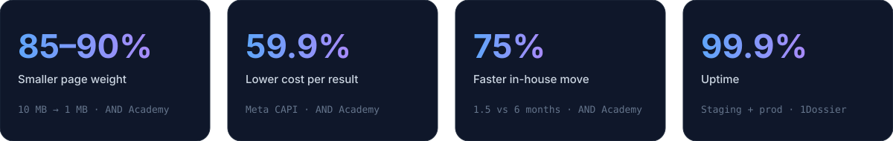

  

  Web developer across frontend, backend, WordPress and PHP, now leading web and AI automation. 
  Senior Manager, Web Development at <b>University of Design, Innovation &amp; Technology</b>. Open to new roles.

  
  
  
  
  

## Measured results

## What I build

- **Frontend:** cut page weight 85–90%, shipped 7 landing pages in one week, held elite Core Web Vitals.
- **Backend:** custom lead-capture APIs and NPF Widget integrations, Google Ads → AWS pipeline, 99.9% uptime.
- **WordPress & PHP:** 20+ projects at 95% on-schedule, single-template landing architecture, Meta Conversions API.
- **AI automation:** MCP servers for internal data, a WhatsApp lead-qualifying bot, a counselor-audit agent.

## Selected projects

Internal company systems, so no public links. Happy to walk through any of them.

- **Single-template landing page system** (AND Academy): 12 legacy files merged into one codebase driven by centralized metadata, lazy loading and nightly triggers. Page weight down 85–90%.
- **Ads intelligence hub** (AND Academy): custom Google Ads MCP server so Claude can query campaigns, plus a Google Ads → AWS → Meritto CRM pipeline that maps spend to individual leads.
- **Admissions real-time dashboard** (AND Academy): CRM → Google Sheets pipeline (Python, cron, webhooks, AWS EC2) with a live dashboard that tells counselors who to call first.
- **MCP servers for Claude and Notion AI** (UDIT): teams query live admissions data in plain language, backed by Python services keeping Meritto CRM and CAMU in sync.

## Experience

| When | Role |
|---|---|
| Aug 2026 – present | **Senior Manager, Web Development**, University of Design, Innovation & Technology. Took website control in-house within a month, shipped 7 landing pages in a week, built CRM ↔ Notion AI integrations and MCP servers, deployed the Voicebot system. |
| Aug 2025 – present | **Senior Manager, Web Development**, AND Academy (contractual since Aug 2026). AI-driven marketing and analytics, Meta CAPI, WhatsApp automation, real-time dashboards, UX/UI overhaul. |

Earlier roles and the full CV: [resume site](https://137-23-59-146.sslip.io/) · [LinkedIn](https://www.linkedin.com/in/bhanugupta01/).

## Currently

- Building MCP servers that let Claude and Notion AI read live admissions data.
- Running a WhatsApp agent that qualifies leads from Meta Ads and website entry points.
- Open to new roles in web development and AI automation.
