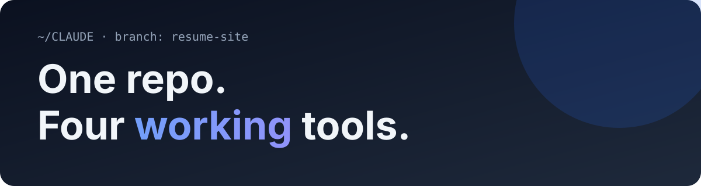

<p align="center">
  
</p>

<p align="center">
  A personal workspace: a live resume site, CRM lead analysis scripts, a WhatsApp qualification agent, and the Claude Code setup that keeps sessions lean.
</p>

<p align="center">
  
  
  
</p>

## Projects

| | Project | What it does | Status |
|---|---|---|---|
| 🌐 | **Resume site** | Single-page personal site, self-hosted fonts, one-page CV, PDF downloads, tiny visit counter. | Live |
| 📊 | **UDIT lead analysis** | Pulls leads from the Meritto CRM API, detects stage changes, serves local dashboards. | Paused |
| 💬 | **WhatsApp agent** | Lead-qualify workflow and WhatsApp automation skills for first-touch conversations. | Active |
| ⚙️ | **Claude Code setup** | Agents, hooks, skills and a `CLAUDE.md` enforcing terse output, diffs over rewrites, tool discipline. | Active |

## Layout

```text
CLAUDE-CODE/
├─ resume-site/           static site: index.html, CV, fonts, visits.py
├─ UDIT LEADS ANALYSIS/   CRM scripts, dumps, dashboards
├─ wa-agent/              workflows + skills-lock.json
├─ .claude/               agents, hooks, skills, launch.json
└─ CLAUDE.md              efficiency protocol
```

## Quick start

```bash
# preview the resume site
cd resume-site && python3 -m http.server 8000

# pull leads (needs CRM keys in an untracked .env)
cd "UDIT LEADS ANALYSIS" && python3 get_npf_leads.py
```

Secrets stay in untracked `.env` files. Nothing here needs a build step.
